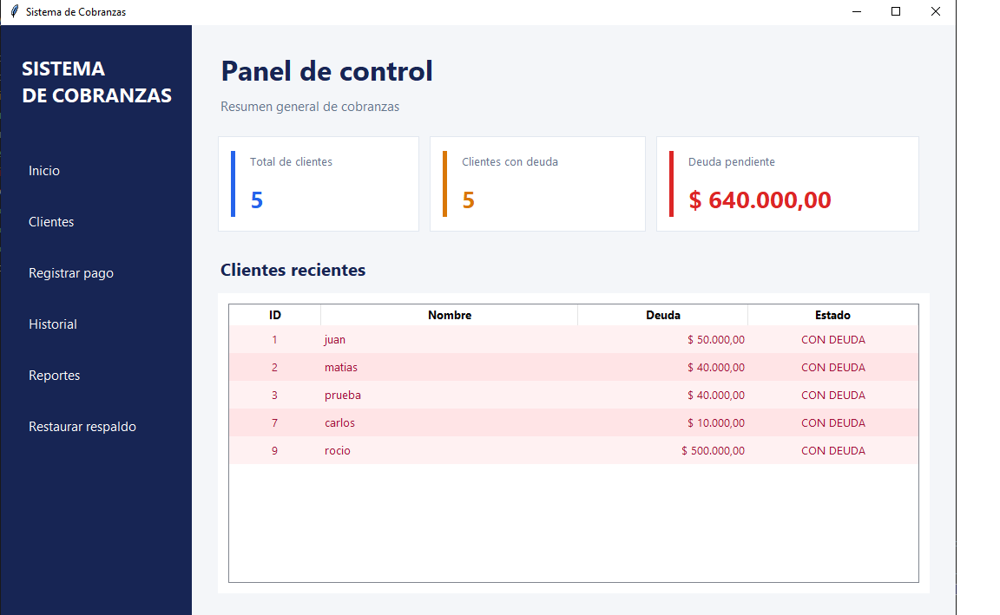
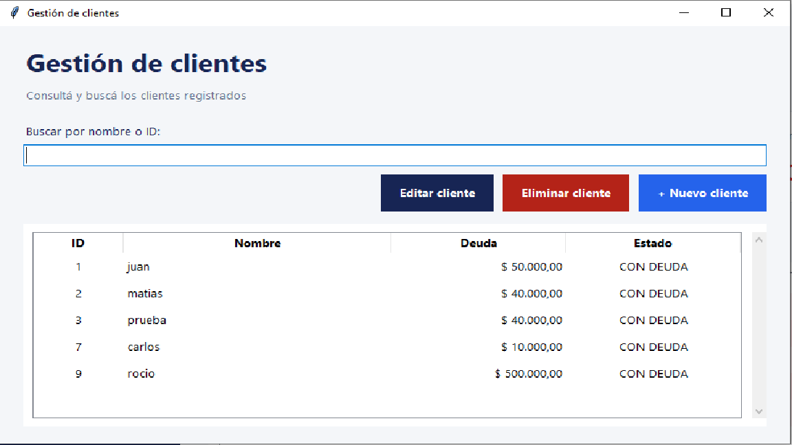
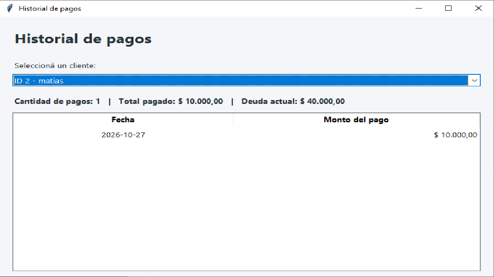
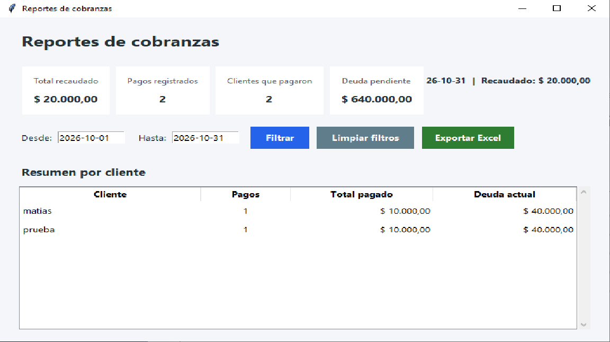

# Sistema de Cobranzas en Python


## 📥 Descargar aplicación para Windows

[⬇️ Descargar Sistema de Cobranzas v0.1.0](https://github.com/MatiasDaniel28/sistema-cobranzas/releases/tag/v0.1.0)

### Cómo utilizarlo

1. Descargá el archivo `SistemaDeCobranzas_v0.1.0_Windows.zip`.
2. Extraé el contenido en una carpeta de tu computadora.
3. Ejecutá `SistemaDeCobranzas.exe`.

No requiere instalar Python.

Los datos se guardan automáticamente en un archivo `clientes.json` junto al ejecutable.


Sistema de gestión de clientes y cobranzas desarrollado en Python, con interfaz gráfica creada mediante Tkinter y una versión alternativa para consola.

Permite administrar clientes, controlar deudas, registrar pagos, consultar historiales y generar reportes exportables a Excel.

**Proyecto personal desarrollado con fines de aprendizaje y portfolio profesional.**


## Capturas de pantalla

### Panel principal



### Gestión de clientes



### Historial de pagos



### Reportes de cobranzas



## Funcionalidades principales

### Gestión de clientes
- Registrar nuevos clientes con nombre y deuda inicial.
- Consultar y buscar clientes por nombre o ID.
- Editar nombres y deudas.
- Eliminar clientes con confirmación.
- Identificar clientes con deuda pendiente o cancelada.

### Gestión de cobranzas
- Registrar pagos parciales o totales.
- Actualizar automáticamente las deudas pendientes.
- Consultar el historial de pagos por cliente.
- Registrar modificaciones realizadas sobre los clientes.

### Panel de control
- Visualizar la cantidad total de clientes.
- Consultar cuántos clientes tienen deuda.
- Mostrar el importe total de deuda pendiente.
- Consultar una tabla de clientes con actualización automática.
- Identificar visualmente el estado de las deudas.

### Reportes y exportación
- Consultar las cobranzas registradas.
- Filtrar pagos por períodos de fechas.
- Visualizar indicadores de recaudación.
- Consultar reportes individuales por cliente.
- Exportar los resultados a archivos Excel (.xlsx).
- Generar totales automáticos en los reportes exportados.

### Seguridad de los datos
- Almacenamiento local mediante archivos JSON.
- Validaciones para evitar datos incorrectos.
- Escritura mediante archivos temporales.
- Copias de seguridad automáticas antes de operaciones importantes.
- Restauración de respaldos mediante la interfaz gráfica.
- Exclusión de datos privados y respaldos mediante `.gitignore`.

## Tecnologías utilizadas

- **Python:** lenguaje principal.
- **Tkinter:** interfaz gráfica de escritorio.
- **JSON:** almacenamiento de la información.
- **openpyxl:** generación y formato de reportes Excel.
- **unittest:** pruebas automatizadas.
- **Git y GitHub:** control de versiones y publicación del proyecto.

## Estructura del proyecto

- `main.py` — versión de consola.
- `interfaz.py` — interfaz gráfica de escritorio.
- `test_cobranzas.py` — pruebas automatizadas.
- `README.md` — documentación del proyecto.
- `.gitignore` — exclusión de archivos privados y temporales.
- `clientes.json` — archivo de datos local, no incluido en el repositorio.
- `backups/` — carpeta de respaldos generada durante el uso.


## Requisitos

### Versión ejecutable para Windows

- Sistema operativo Windows.
- No requiere instalar Python ni sus bibliotecas.
- Permisos de escritura en la carpeta donde se ejecuta el programa.

### Ejecución desde el código fuente

- Python 3.
- Tkinter disponible en la instalación de Python.
- Biblioteca `openpyxl` para exportar reportes a Excel.

## Instalación

Clonar el repositorio:

```bash
git clone https://github.com/MatiasDaniel28/sistema-cobranzas.git
```

Ingresar a la carpeta:

```bash
cd sistema-cobranzas
```

Instalar la dependencia para Excel:

```bash
python -m pip install openpyxl
```


### Almacenamiento de datos

La aplicación guarda la información de los clientes en un archivo `clientes.json`.

Si el archivo no existe, la interfaz gráfica lo crea automáticamente al iniciarse con una base de clientes vacía.

No es necesario crear el archivo manualmente.

Los datos se almacenan localmente y no se incluyen en el repositorio de GitHub.


## Ejecutar la aplicación

**Interfaz gráfica:**

```bash
python interfaz.py
```

**Versión de consola:**

```bash
python main.py
```

## Ejecutar las pruebas

Desde la carpeta del proyecto:

```bash
python -m unittest -v test_cobranzas.py
```

El proyecto incluye pruebas automatizadas para funcionalidades de la versión de consola. Las modificaciones posteriores deben verificarse ejecutando nuevamente las pruebas.

## Copias de seguridad

La aplicación genera respaldos antes de guardar cambios importantes en la información de los clientes.

Los respaldos se almacenan en la carpeta `backups/`.

También es posible seleccionar y restaurar una copia anterior mediante la interfaz gráfica.

**Advertencia:** restaurar una copia reemplaza la información completa del archivo de clientes. Se recomienda comprobar el respaldo antes de confirmar la operación.

## Estado del proyecto

**Versión 0.1.0 publicada — aplicación funcional para Windows.**

La primera versión portátil se encuentra disponible en GitHub Releases.

Próximas mejoras previstas:

- Ampliar las pruebas automatizadas de la interfaz gráfica.
- Mejorar la validación y el manejo de errores.
- Agregar nuevas funciones de búsqueda y filtrado.
- Mejorar el diseño visual de la aplicación.
- Implementar nuevas funcionalidades para la gestión de cobranzas.


## Objetivo del proyecto

Este proyecto forma parte de mi aprendizaje de desarrollo de software con Python.

El objetivo es aplicar conocimientos de programación, organización del código, persistencia de datos, validaciones, interfaces gráficas, pruebas automatizadas y control de versiones mediante Git.

El desarrollo se encuentra en evolución y está destinado a demostrar habilidades prácticas como parte de mi portfolio profesional.